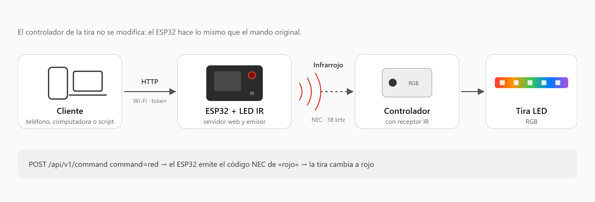
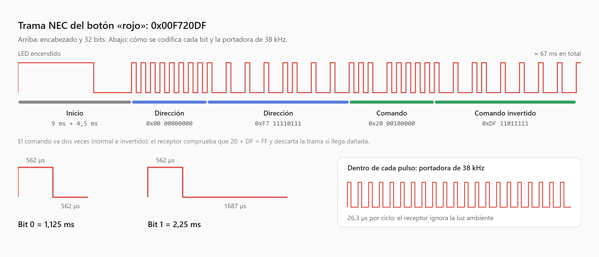
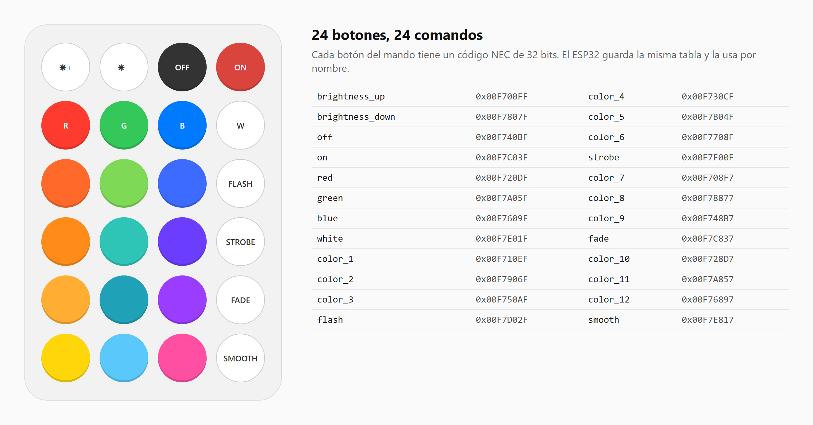

# Control de una tira LED RGB de mando infrarrojo con un ESP32 y un LED IR

Muchas tiras LED RGB se venden con un controlador que solo obedece a su mando infrarrojo. Este proyecto pone un ESP32 con un LED infrarrojo frente a ese controlador para que la tira se pueda manejar por Wi‑Fi, con peticiones HTTP, sin abrir ni modificar nada.

El ESP32 hace lo mismo que el mando: cuando recibe una orden por la red, emite el código infrarrojo del botón correspondiente.



## Cómo funciona

1. Un cliente (teléfono, computadora o script) envía una petición HTTP al ESP32 con el nombre del botón, por ejemplo `red`.
2. El ESP32 comprueba el token, busca el código de ese botón en su tabla y lo emite por el LED infrarrojo.
3. El controlador de la tira recibe la señal como si viniera del mando y cambia el color.

La comunicación es en un solo sentido: el controlador no responde, así que el ESP32 sabe qué orden envió, pero no puede confirmar que la tira la recibió.

## La señal infrarroja

El mando usa el protocolo NEC. Cada pulsación es una trama de unos 67 ms: un encabezado de 9 ms + 4,5 ms y 32 bits, que son la dirección del aparato, el comando y el comando invertido. El receptor comprueba que comando + comando invertido = `FF` y así descarta tramas dañadas.

Cada bit empieza con un pulso de 562 µs. Lo que distingue un 0 de un 1 es la pausa que sigue. Dentro de cada pulso, el LED parpadea a 38 kHz. El receptor solo reacciona a esa frecuencia, por eso la luz ambiente no lo activa.



## Los botones

El mando tiene 24 botones: encendido, apagado, brillo, 16 colores y 4 efectos. El firmware guarda los 24 códigos con un nombre fijo, y las peticiones usan ese nombre.



Los códigos de la tabla son los del mando de 24 botones más común (dirección `0x00F7`). Si tu mando usa otros, se leen con un receptor IR y se cambian en la tabla `COMMANDS`.

## El código

Todo está en [`control_tira_led_ir/control_tira_led_ir.ino`](control_tira_led_ir/control_tira_led_ir.ino):

- **Conexión:** se une a la red Wi‑Fi y se anuncia como `tira-led.local` (mDNS).
- **Servidor web:** atiende dos rutas. Las dos exigen la cabecera `Authorization: Bearer <token>`.
- **Emisión:** envía el código con `IRsend::sendNEC` de la biblioteca IRremoteESP8266.
- **Límite:** rechaza órdenes que lleguen a menos de 120 ms de la anterior, para que no se mezclen dos tramas.
- **Reconexión:** si se pierde el Wi‑Fi, vuelve a conectarse cada 10 s.

| Ruta | Método | Qué hace |
|---|---|---|
| `/api/v1/status` | GET | Devuelve IP, señal Wi‑Fi, tiempo encendido y último comando. |
| `/api/v1/command` | POST | Emite el botón indicado en `command`. |

Ejemplos:

```sh
curl -H "Authorization: Bearer TU_TOKEN" http://tira-led.local/api/v1/status

curl -X POST -H "Authorization: Bearer TU_TOKEN" -d "command=on"  http://tira-led.local/api/v1/command
curl -X POST -H "Authorization: Bearer TU_TOKEN" -d "command=red" http://tira-led.local/api/v1/command
```

Respuestas posibles de `/api/v1/command`:

| Código | Cuerpo | Significado |
|---|---|---|
| 200 | `{"sent":true,"command":"red"}` | Código emitido. |
| 400 | `{"error":"unknown_command"}` | El nombre no está en la tabla. |
| 401 | `{"error":"unauthorized"}` | Falta el token o no coincide. |
| 429 | `{"error":"rate_limited"}` | Llegó demasiado pronto tras la anterior. |

## Montaje y carga

1. En Arduino IDE, instala el soporte para placas ESP32 y la biblioteca **IRremoteESP8266**.
2. Abre el `.ino` y cambia `WIFI_SSID`, `WIFI_PASS` y `API_TOKEN`. Si tu LED IR está en otro pin, cambia también `IR_PIN`.
3. Carga el programa. En el monitor serie (115200 baudios) aparece la IP que le dio el router.
4. Coloca el ESP32 con el LED apuntando al receptor del controlador, con línea de vista.

Si usas un LED IR suelto en vez de uno integrado, conéctalo con un transistor y una resistencia: un pin del ESP32 no da corriente suficiente para un buen alcance.

## Lo que usamos nosotros

- **M5Stack ATOM S3 Lite:** un ESP32‑S3 que ya trae el LED infrarrojo en el GPIO 4, así que no hizo falta soldar nada.
- **Tira LED RGB** con su controlador IR y mando de 24 botones.
- **Alimentación:** el ATOM por USB‑C y la tira con su propia fuente.
- **Control:** peticiones HTTP desde la red local.
